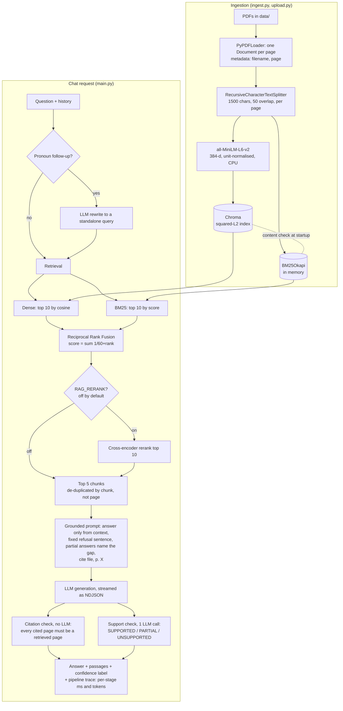
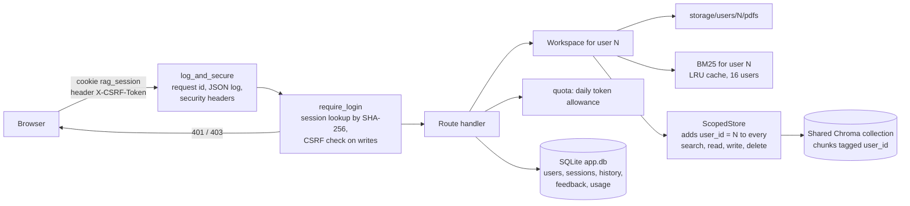

# Architecture

A local, evidence-grounded RAG system over your own PDFs. Retrieval and embeddings run on CPU; only answer generation (and an optional grounding check) calls a hosted LLM (Groq, `openai/gpt-oss-120b`).

## Pipeline



## Request lifecycle and isolation



Quiz and Compare reuse the same hybrid retrieval with a per-paper metadata filter applied to *both* retrievers (BM25 is rebuilt over that paper's chunks), so evidence from one paper can never leak into another's answer.

## Components

| Module | Responsibility |
|---|---|
| `auth.py` | Registration, Argon2id hashing, sessions (hashed tokens), CSRF tokens, login throttling |
| `db.py` | SQLite via the standard library; numbered migrations; one short-lived connection per call |
| `workspace.py` | One user's library: private files, `ScopedStore` over the shared Chroma collection, per-user BM25 |
| `quota.py` | Daily LLM token allowance per user |
| `manage.py` | Admin commands: `users`, `import-pdfs`, `reindex` |
| `config.py` | Single source of truth: paths, models, chunking, top-k, retrieval switches (`RAG_*` env vars), the answer prompt, citation formatting |
| `ingest.py` | Load PDFs, split, embed, rebuild `chroma_db/` from scratch |
| `upload.py`, `library.py` | Add / rename / remove a PDF with rollback, so a failed upload leaves no partial index entries |
| `hybrid.py` | The one live retrieval pipeline: BM25, dense (true cosine), RRF, optional rerank, optional stage-by-stage trace; `unique_chunks` |
| `llm.py` | The one Groq client: lazy creation, retry/backoff for 429 and transient errors, streaming, token-usage accounting |
| `citations.py` | Deterministic citation validation (shared by the app and the evaluation) |
| `trust.py` | Confidence label = retrieval strength × LLM support verdict (a heuristic; see its calibration in `eval/`) |
| `quiz.py`, `compare.py` | Grounded quiz generation/grading with citation validation; two-paper comparison with isolated evidence |
| `main.py` | FastAPI app: REST + NDJSON streaming, index lifecycle, error mapping, static frontend |
| `static/` | Vanilla JS single page (Chat, Quiz, Compare, Inspect); no build step |
| `eval/` | Zero-LLM retrieval harness, ablations, error analysis, answer-quality evaluation |

## Key design decisions

| Decision | Why | Evidence |
|---|---|---|
| Hybrid BM25 + dense with RRF | The retrievers fail on different questions: BM25 12/12 exact-term but 6/13 paraphrase; dense the reverse | `eval/RETRIEVAL_COMPARISON.md` |
| RRF instead of score averaging | Cosine and BM25 scores live on incomparable scales; RRF uses ranks only and needs no calibration | k = 60 from the RRF paper, fixed before measurement |
| Top-k 5 (not 3 or 8) | Never loses a hit vs 3, gains on both sets, multi-hop full coverage 5/10 → 8/10; 8 costs +143% prompt tokens | `eval/ABLATION.md` |
| 1500-char chunks, per page | Best of an 8-config grid; cross-page and 1000-char variants lost on dev | `eval/ABLATION.md` |
| No reranker by default | MiniLM loses on dev; BGE gains 1 held-out question at ~3 s/query on CPU | `eval/RETRIEVAL_COMPARISON.md` |
| No score-based abstention | No retrieval score separates unanswerable questions (AUC 0.61–0.72); the prompt already refuses 13/13 | `eval/ABSTENTION_SIGNALS.md` |
| De-duplicate by chunk, not page | Page-level de-duplication dropped the answer-bearing chunk: evidence in prompt 35/47 → 40/47 after the fix | `eval/CONTEXT_COVERAGE.md` |
| Isolation in the storage layer (`ScopedStore`), not in each route | Routes cannot forget a filter they never see; forged `user_id` metadata is overwritten | `test_isolation.py` (real PDFs, embeddings, Chroma; two users) |
| One auth middleware for all `/api` routes | Secure by default: a new route is protected without anyone remembering | `test_auth.py` sweeps every route anonymously |
| Server-side sessions, not JWT | Revocable on sign-out; only a SHA-256 of the token is stored | `test_auth.py` |
| BM25 corpus re-split, then verified against Chroma by content | Keeps the exact chunk order the evaluation measured (RRF ties break by position) while failing loudly on drift | `main.verify_index_matches` |

## API

| Method | Path | Purpose |
|---|---|---|
| POST | `/api/auth/register`, `/api/auth/login`, `/api/auth/logout` | Account and session (the only open `/api` routes) |
| GET | `/api/auth/me`, `/api/usage` | Signed-in user; today's token use against the allowance |
| GET | `/healthz` | Public liveness probe (no data) |
| GET | `/api/health` | The user's index readiness, paper/chunk counts, whether an API key is set |
| GET | `/api/settings` | Live top-k, models, chunking |
| POST | `/api/chat` | Answer with passages, citation check, confidence label, `trace` |
| POST | `/api/chat/stream` | Same, as NDJSON events: `meta` → `token`* → `done` (the answer, final) → `trust` (confidence label, after the support check); `error` instead on failure |
| POST | `/api/retrieval/inspect` | Retrieval only, no LLM: every candidate with dense/BM25 rank and score, RRF score, what is sent |
| GET | `/api/eval/summary` | Recorded benchmark results (never computed on the fly) for the dashboard |
| POST | `/api/quiz/generate`, `/api/quiz/grade` | Grounded quiz generation and grading |
| POST | `/api/compare` | Two-paper comparison with isolated evidence |
| GET/POST/DELETE | `/api/library…`, `/api/upload` | Library management, preview, open PDF |
| GET/POST | `/api/progress…`, `/api/chat/feedback` | Quiz history and answer ratings (local JSON files) |

Interactive API docs: <http://127.0.0.1:8000/docs> (FastAPI's OpenAPI UI).

### Pipeline trace (in every chat response)

A real trace, measured on this machine for "What LSAT score did GPT-4 achieve, and what percentile is that?" (token totals abbreviated):

```json
"trace": {
  "timings_ms": {"rewrite": 0.0, "retrieval": 29.1, "first_token": 1190.9, "generation": 1263.3, "support_check": 494.8, "total": 1792.6},
  "tokens": {"generation": {"total_tokens": 2662}, "support_check": {"total_tokens": 2614}, "total": 5276},
  "retrieval": [{"paper": null, "timings_ms": {"bm25_ms": 1.52, "dense_ms": 27.06, "fusion_ms": 0.03}, "candidates": [...]}]
}
```

Retrieval is under 2% of the time; the hosted LLM dominates. A second question within the same minute measured a 14.9 s support check, waiting on Groq's per-minute token limit.
