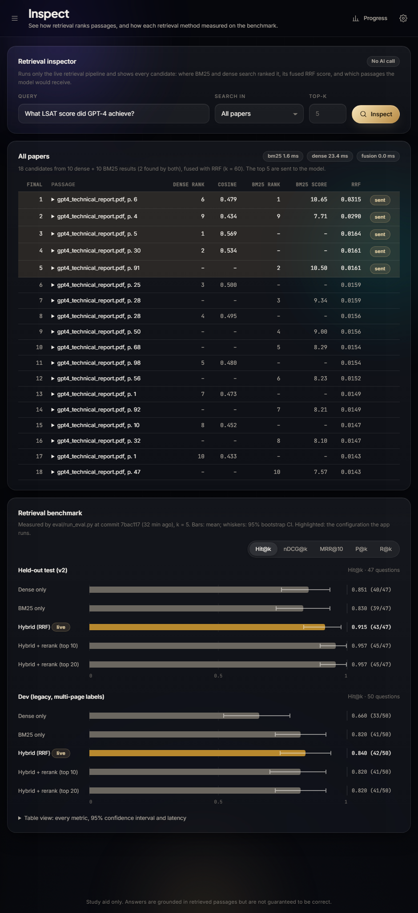
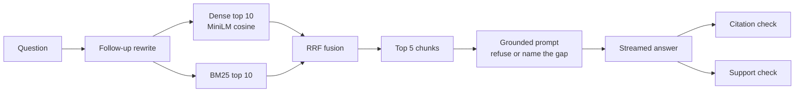

# Hybrid RAG Assistant

[](.github/workflows/ci.yml)

Evidence-grounded question answering, quizzes and paper comparison over your own PDFs. Every answer comes only from retrieved passages, cites its pages, and has those citations checked automatically. Retrieval quality is measured, not assumed: every retrieval setting in this repo was chosen, or rejected, by a reproducible zero-LLM benchmark with confidence intervals.



## What it does

- **Chat:** search all papers or pick several; with two or more selected, the answer covers each paper separately, saying when one doesn't address the question. Answers come from hybrid retrieval (BM25 + dense embeddings, fused with Reciprocal Rank Fusion), with clickable page citations, the retrieved passages, a citation check, a confidence label, and a **pipeline trace** (time and tokens per step). Answers stream in. Follow-up questions ("how does *it* compare…") are rewritten into standalone searches.
- **Quiz:** questions generated from one paper, each citing a retrieved passage. Multiple-choice and true/false answers are graded against the answer key; free-text answers are graded by the LLM against the same passages.
- **Compare:** two papers answered from *isolated* evidence, so passages from one can never leak into the other's answer.
- **Inspect:** a retrieval debugger (every candidate's dense rank, cosine, BM25 rank and score, RRF score, and which passages reach the model) plus a dashboard of the recorded benchmark.
- **Library:** upload, preview, rename and delete PDFs; indexing is immediate and the dense and lexical indexes are verified to match.
- **Accounts:** email and password sign-in with email verification, password reset and change by emailed code, and account settings; every user has a **private** library, search index, quiz history and daily AI allowance. Isolation is enforced in the storage layer and tested end to end ([below](#accounts-and-security)).

Embeddings (`all-MiniLM-L6-v2`), the Chroma index and BM25 run locally on CPU. Only generation calls the hosted LLM (Groq, `openai/gpt-oss-120b`).

## Results (measured)

Retrieval, top-k 5, held-out set of 47 questions with page-level gold labels ([full report](eval/RETRIEVAL_COMPARISON.md)):

| Configuration | Hit@5 | nDCG@5 | MRR@10 | Latency (CPU, median) |
|---|---|---|---|---|
| Dense only | 85% (40/47) | 0.390 | 0.657 | 14 ms |
| BM25 only | 83% (39/47) | 0.454 | 0.750 | 1 ms |
| **Hybrid RRF (live)** | **91% (43/47)** | **0.473** | **0.750** | **17 ms** |
| Hybrid + cross-encoder rerank | 96% (45/47) | 0.540 | 0.876 | 501 ms |

- Hybrid beats dense-only (dev set: 9 questions better, 0 worse; nDCG@5 better on both sets, CIs exclude zero). It is **not** shown to beat BM25 alone on this corpus: the differences fall inside the confidence intervals.
- The reranker is **off by default**: it wins on the held-out set but loses on the dev set (3 better, 4 worse) under a rule fixed before measuring. `RAG_RERANK=1` turns it on.
- Fixing a de-duplication bug raised "full gold evidence reaches the prompt" from **35/47 to 40/47** ([CONTEXT_COVERAGE.md](eval/CONTEXT_COVERAGE.md)).

Answers, held-out set, the app's own model and prompt, judged by a second model ([full report](eval/ANSWER_QUALITY_k5_stage4.md)):

| | Before this upgrade | Now |
|---|---|---|
| Correct answers | 38/47 (81%) | **41/47 (87%)**: 3 better, 0 worse (paired) |
| False refusals | 9/47 (19%) | **4/47 (9%)**, all four where retrieval missed the answer |
| Unanswerable questions declined | 13/13 | 12/13 by the strict metric. The 13th states the documents do not cover it, without the fixed sentence |
| Answer sentences supported by the passages | 90% (46/51) | **93% (55/59)** |
| Citations to a page that was not retrieved | 2 of 49 | 2 of 55, flagged in the UI by the citation check |

The three newly correct answers are exactly the questions whose answer chunk an old de-duplication bug used to drop. With 47 questions the confidence intervals overlap (81% [68–90] vs 87% [75–94]), so the paired 3-better / 0-worse count is the stronger evidence.

A chat answer takes about 1.8 s end to end (measured: retrieval 29 ms, first token 1.2 s, support check 0.5 s) and about 5,300 tokens, half of them for the grounding check. On Groq's free tier (about 8k tokens per minute for this model), a second question within the same minute waits for the rate limit.

## Quick start (Windows / PowerShell)

Detailed steps and troubleshooting: [HOW_TO_RUN.md](HOW_TO_RUN.md).

```powershell
cd autonomous-rag-agent
python -m venv venv
.\venv\Scripts\Activate.ps1
python -m pip install -r requirements.txt
Copy-Item .env.example .env      # then set GROQ_API_KEY=... (free key: https://console.groq.com/keys)
python ingest.py                 # build the index from data/*.pdf
.\run_api.bat                    # or: python -m uvicorn main:app --port 8000
```

Open <http://127.0.0.1:8000>, choose **Create account**, then upload PDFs (or import a folder: stop the server, `python manage.py import-pdfs --email you@example.com data\*.pdf`). API docs: <http://127.0.0.1:8000/docs>.

Docker (not built or tested in the development environment): `docker build -t hybrid-rag .` then `docker run -p 8000:8000 --env-file .env -v rag-data:/data hybrid-rag`.

Demo path: ask a question in **Chat** → open **Pipeline trace** under the answer → click the search icon to see that question in **Inspect** → switch the benchmark metric to nDCG@k.

## How it works



Design decisions and the evidence for each: [ARCHITECTURE.md](ARCHITECTURE.md). How to explain them in an interview: [INTERVIEW_GUIDE.md](INTERVIEW_GUIDE.md).

## Accounts and security

| Concern | How it is handled |
|---|---|
| Passwords | Argon2id hashes (never stored or logged in plain text); minimum 10 characters; rehashed when parameters change |
| Sessions | Random 256-bit token in an `HttpOnly`, `SameSite=Lax` cookie; only its SHA-256 is stored; 7-day expiry; revoked on sign-out |
| CSRF | Per-session token echoed in `X-CSRF-Token` on every write; cross-site writes to sign-in endpoints rejected by `Origin` |
| Brute force | 5 failed sign-ins per email (and per client) lock sign-in for 15 minutes; one generic error for wrong password and unknown email, with equal hashing cost |
| Email verification and reset | New accounts verify their email with a 6-digit code; **Forgot password** resets by emailed code and signs out every session; **change password** needs the current one and signs out other devices. Codes are random, stored hashed, expire in 10 minutes, allow 5 guesses, and are limited to one a minute and five an hour. Email-only endpoints answer identically whether or not an account exists. Mail is sent server-side through EmailJS, so the browser never sees a code |
| Every route protected | One middleware requires a session for all `/api` routes except sign-in, so a new route cannot be left open by accident (tested by sweeping every route) |
| Data isolation | Private folder per user; per-user BM25; a `ScopedStore` adds the user's filter to every Chroma search, read, write and delete; fusion only accepts the user's own chunks |
| Leaving | **Delete account** (password required) erases the user's PDFs, parsed-text cache, vectors, sessions, history, feedback, usage and codes; the search index and files go first and the account row last, so a failure part-way can be retried. Tested end to end, including that other users' data survives |
| Shared API key | Daily LLM token allowance per user (`APP_DAILY_TOKEN_LIMIT`, default 100,000) |
| Browser hardening | Content-Security-Policy, `nosniff`, frame denial, same-origin referrer |
| Observability | One JSON log line per API request (status, latency, user id, request id); bodies, query strings and cookies are never logged |

`test_isolation.py` uploads real PDFs with secret tokens for two users and attempts every cross-user path (listing, preview, download, delete, search, chat prompt, quiz, compare, progress, identical filenames, path traversal) with real embeddings and a real Chroma index.

**Not provided:** two-factor sign-in, HTTPS (put a reverse proxy in front and set `APP_SECURE_COOKIES=1` before exposing it beyond localhost).

## Evaluation

All retrieval experiments make **zero LLM calls** (the harness blocks the client at import) and use their own index, so they never touch what the app serves.

| Script | Measures |
|---|---|
| `eval/run_eval.py` | Hit@k, MRR@10, Precision@k, Recall@k, nDCG@k, per-stage latency; bootstrap CIs and paired deltas vs the live config |
| `eval/ablation.py` | Each retrieval change against the adoption rule (no loss on dev, gain on held-out) |
| `eval/context_coverage.py` | Whether the gold evidence actually reaches the prompt |
| `eval/abstention_signals.py` | Whether any retrieval score can tell answerable from unanswerable questions |
| `eval/answer_eval.py` | Correctness, faithfulness, citations, refusals, label calibration (LLM judge; cached and quota-paced) |
| `eval/validate_questions.py` | Every gold evidence quote appears verbatim on its labelled page |

```powershell
python eval/run_eval.py --top-k 5                                   # held-out set
python eval/run_eval.py --questions eval/dev_questions_multipage.json --top-k 5
```

**Continuous integration** ([`ci.yml`](.github/workflows/ci.yml)) runs on every push and pull request, without an API key: the full test suite, then a **retrieval regression gate**. Live hybrid retrieval must keep hit@5 ≥ 89% on the 29 held-out questions whose PDFs are committed (measured 28/29 when the gate was added), so a change that quietly degrades retrieval fails the build.

**Limitations of the evaluation:** 47–50 questions per set, so CIs span about ±10 points; held-out labels are machine-validated but not yet human-reviewed; two held-out PDFs (`ML111.pdf`, `ML222.pdf`) are not in the repository, so 18 held-out questions cannot be reproduced from a clone.

## Tests

```powershell
python -m unittest discover -p "test_*.py"
```

155 tests, all offline (no API key needed). LLM calls are replaced by fakes. The isolation tests use real PDFs, embeddings and Chroma; the rest use in-memory fakes.

## Project layout

| Path | Purpose |
|---|---|
| `main.py` | FastAPI app: REST + NDJSON streaming, auth middleware, request logging, static frontend |
| `auth.py`, `db.py`, `quota.py` | Accounts, sessions, CSRF, throttling; SQLite with migrations; daily token allowance |
| `workspace.py` | Per-user library: private files, scoped dense index, per-user BM25 |
| `manage.py` | `users`, `import-pdfs`, `reindex` |
| `hybrid.py` | The live retrieval pipeline: BM25, dense, RRF, optional rerank, stage trace |
| `llm.py` | Groq client: lazy, retrying, streaming, token accounting |
| `config.py` | Paths, models, chunking, top-k, `RAG_*` switches, the answer prompt |
| `ingest.py`, `upload.py`, `library.py` | Index build, safe upload, rename and delete |
| `citations.py`, `trust.py` | Citation validation; confidence label |
| `quiz.py`, `compare.py` | Grounded quiz and two-paper comparison |
| `static/` | Vanilla JS frontend, no build step |
| `eval/` | Benchmarks, question sets, reports |
| `legacy/` | Earlier experiments and command-line demos, kept so their recorded results stay reproducible; superseded by `eval/` ([what each one was](legacy/README.md)) |
| `docs/archive/` | The original project report (its numbers are superseded) |

Runtime data (git-ignored): `app.db` (accounts, sessions, history, usage) and `storage/` (each user's PDFs and the shared, user-tagged vector index). `chroma_db/` is the single-user index used by the legacy CLI scripts.

> Study aid only. Answers are grounded in retrieved passages but are not guaranteed to be correct.
